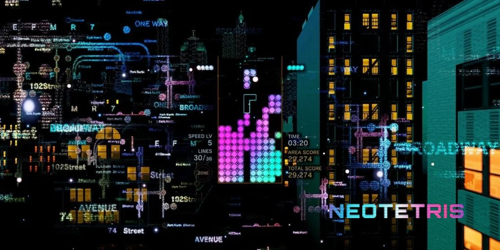
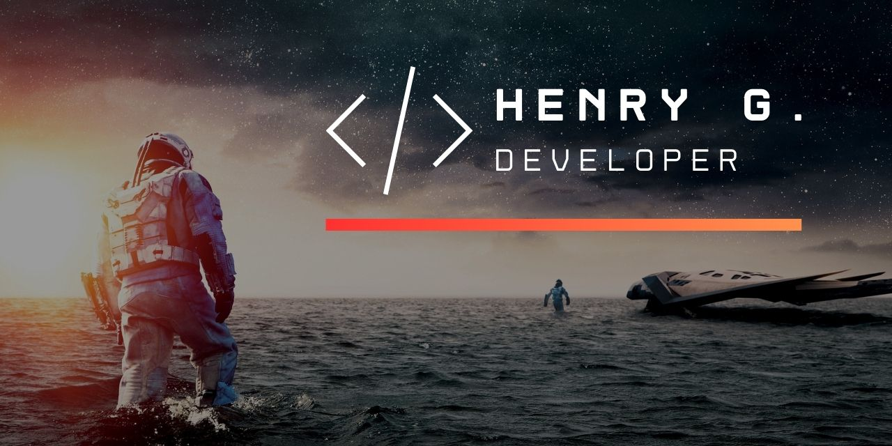

<h1 align="center">
  
</h1>

<p align="center">
  <b>Tetris cyberpunk nel browser</b><br>
  Classifica globale condivisa, effetti neon e controlli touch — giocabile da desktop e mobile.
</p>

<p align="center">
  <a href="https://neotetris.henrydev.it/"></a>
  
  
  
  
</p>

<div align="center">
  
</div>

## 🚀 Panoramica

**NEOTETRIS** è un Tetris in stile cyberpunk che gira interamente nel browser: i sette tetramini classici, le regole moderne (7-bag, hold, ghost piece, SRS) e un'estetica neon fatta di griglia animata, scanline CRT e particelle.

Il progetto è un **monorepo** con due pacchetti: un client **React 19 + Vite 8** (JSX, nessun TypeScript) e un server **Express 4 + Mongoose 8** che espone le API della classifica. In produzione **un solo container** serve sia la SPA compilata sia le API sulla stessa origine, con **MongoDB** in un container separato e volume persistente.

La classifica è **unica per tutti**: quando l'API risponde, la schermata mostra solo le righe del server, quindi due dispositivi vedono lo stesso ranking e battere il record di qualcun altro è reale. Le partite salvate sul dispositivo compaiono solo offline, sotto il badge `LOCAL`.

🌐 **Gioca Online**: [https://neotetris.henrydev.it/](https://neotetris.henrydev.it/)

## 🎮 Caratteristiche Principali

### Gameplay
- **7 tetramini** (I, O, T, S, Z, J, L) con colori dedicati
- **7-bag randomizer** — distribuzione equa dei pezzi, niente siccità infinite
- **Next queue ×3** — i prossimi tre pezzi sempre visibili
- **Hold** — metti da parte un pezzo e richiamalo quando serve (una volta per discesa)
- **Rotazione SRS** con **wall kick**: i pezzi scivolano via da muri, pavimento e stack
- **Lock delay** di **500 ms** con un massimo di **15 reset** per pezzo
- **Ghost piece** — mostra dove atterrerà il pezzo
- **Hard drop** istantaneo e **soft drop** progressivo
- **Rotazione nei due sensi**, oraria e antioraria
- **Pausa** — congela gravità e input senza perdere la partita
- **15 livelli di velocità**, da 800 ms a 30 ms per tick
- **Punteggio classico**: 100 / 300 / 500 / 800 punti per 1 / 2 / 3 / 4 linee, moltiplicati per il livello corrente
- **Combo** — le chiusure consecutive vengono segnalate e premiate visivamente

### 🎨 Estetica Cyberpunk
- **Griglia animata** che scorre verso il basso
- **Scanline CRT** in sovrimpressione per il feeling da monitor retrò
- **Particelle fluttuanti** e **data stream** in stile Matrix ai bordi dello schermo
- **Glow ambientale pulsante** dal ciano al magenta
- **Ambiente reattivo al livello**: l'intensità dello sfondo segue il livello corrente (`--level`, con tetto a 10)

### ✨ Juice & FX
- **Flash di riga** e **burst neon** a ogni clear
- Banner **`SINGLE`** / **`DOUBLE`** / **`TRIPLE`** / **`TETRIS!`** / **`PERFECT CLEAR`**
- **Badge combo** per le chiusure consecutive
- **Banner di level-up** con colour wash dello sfondo
- **Screen shake** su hard drop, TETRIS e game over
- **Count-up** del punteggio e **ripple** all'atterraggio dell'hard drop
- **Desaturazione del campo** al game over
- Tutto rispetta `prefers-reduced-motion`

### 🔊 Audio Sintetizzato
- Una dozzina di effetti generati al volo con **WebAudio** — nessun file audio nel progetto
- Suoni per movimento, rotazione, lock, hold, clear da 1 a 4 linee, TETRIS, perfect clear, level up, game over, start e click UI
- **Mute** con `M` (o dal pulsante in HUD/rail), scelta ricordata in `localStorage`
- Catena audio gain → compressore (`−18 dB`, 6:1): volume da speaker del telefono senza clipping
- Sblocco del contesto audio al primo gesto, anche dopo un cambio app o un blocco schermo

### 📱 Controlli Mobile
- **Joystick flottante** in basso a sinistra: la base appare sotto il dito e il knob segue il trascinamento
- **DAS** e auto-repeat dedicati (200 ms di attesa, 110 ms di ripetizione, 60 ms per il soft drop)
- **Tap sul joystick** per ruotare, **trascina in alto** per ruotare, **trascina in basso** per il soft drop
- **Pulsanti traslucidi** `DROP` / `HOLD` / `PAUSE`–`PLAY` sopra il campo, a destra, che reagiscono al `pointerdown` (così funzionano anche con due dita)
- **Target ≥ 44px** ovunque e **zero scroll** della pagina
- **Vibrazione** dove il dispositivo la supporta
- Layout a una sola composizione attiva per volta: niente pulsanti nascosti ma focusabili

### 🏆 Classifica
- **Top 10 globale su MongoDB** — **una sola classifica per tutti**, nessuna fusione con le partite locali
- Form del nome al game over (max 20 caratteri, ricordato per la partita successiva)
- `SAVE SCORE` con stati espliciti, poi il blocco **`SAVED AS <NAME> · RANK #N`** in sola lettura
- **Record personale** e badge `NEW RECORD`, salvati in locale
- **Un solo salvataggio per partita**: il nome viene congelato al primo tentativo e `RETRY` rimanda la stessa `key` di idempotenza, quindi un POST andato in timeout non crea una seconda riga
- **Classifica automatica** dopo il salvataggio, con evidenziazione della riga appena inserita
- **Partite a 0 punti escluse**: nessun form, nessun POST, nessun record
- **Fallback offline**: senza server le run restano sul dispositivo e compaiono sotto il badge `LOCAL`

### ♿ Accessibilità
- Controlli reali (`<button>`, `<a>`), mai `div` cliccabili
- Etichette `aria`, punteggio in live region, focus visibile
- Dialog della classifica con **focus trap**, chiusura con `Esc`/backdrop e focus restituito
- `prefers-reduced-motion` rispettato: animazioni decorative spente, count-up istantaneo

## 🕹️ Come Giocare

1. Apri [https://neotetris.henrydev.it/](https://neotetris.henrydev.it/) (o avvia il progetto in locale)
2. Premi **`INITIALIZE`** — oppure `Invio` — per iniziare
3. Muovi e ruota i pezzi per completare righe orizzontali; le righe piene spariscono e ti danno punti
4. Usa **hold** per conservare un pezzo, guarda la **ghost piece** per piazzarlo al meglio
5. Accumula **combo**, sali di livello e prova a entrare nella **Top 10**
6. Al game over inserisci il nome e salva: la classifica si apre da sola con la tua posizione

**Tastiera (desktop)**

| Azione | Tasto |
|---|---|
| Muovi a sinistra / destra | ← / → |
| Soft drop | ↓ |
| Ruota orario | ↑ / X |
| Ruota antiorario | Z |
| Hard drop | Spazio |
| Hold | C / Shift |
| Pausa / riprendi | P / Esc |
| Mute | M |
| Avvia la partita | Invio / Spazio (sulla schermata iniziale) |

**Mobile**

| Azione | Controllo |
|---|---|
| Muovi | Joystick in basso a sinistra |
| Ruota | Tap sul joystick, o trascina in alto |
| Soft drop | Trascina il joystick in basso |
| Hard drop | Pulsante `DROP` in basso a destra |
| Hold | Pulsante `HOLD` |
| Pausa / riprendi | Pulsante `PAUSE` / `PLAY` |

I tasti sono ignorati mentre scrivi nel campo del nome. Al game over `Invio`/`Spazio` non riavviano di proposito: per ricominciare c'è **`REBOOT`**, così un tasto di troppo non cancella il form. Con la classifica aperta è il dialog a gestire la tastiera e `Esc` lo chiude.

## 🛠️ Tecnologie Utilizzate

- **React 19** con **Vite 8** — client SPA in JSX, nessun TypeScript
- **CSS puro** con custom properties e keyframes, nessun framework di stile
- **WebAudio API** per tutti gli effetti sonori, senza asset
- **Express 4** — API REST (`/api/health`, `/api/scores`)
- **Mongoose 8 / MongoDB** — persistenza della classifica, con fallback in memoria
- **`node:test` + `node:assert`** — suite di test per client e server, senza framework
- **Docker multi-stage** — un'immagine, un processo: API + SPA sulla stessa origine
- **GitHub Actions** — deploy automatico via SSH a ogni push su `main`
- **Nginx Proxy Manager + Cloudflare** — TLS e CDN davanti al container

| Livello | Tecnologia |
|---|---|
| Frontend | React 19, Vite 8, ESLint |
| Backend | Node.js, Express 4 |
| Database | MongoDB 7 + Mongoose 8 (opzionale, fallback in memoria) |
| Font | Orbitron, Rajdhani (Google Fonts) |
| Test | `node:test` (client + server) |
| Infrastruttura | Docker, GitHub Actions, Nginx Proxy Manager, Cloudflare |

## 📂 Struttura del Progetto

```
NEOTETRIS/
├── client/                          # SPA React + Vite
│   ├── index.html                   # Shell HTML (viewport-fit=cover)
│   ├── vite.config.js               # Proxy /api → :3001 in dev
│   ├── eslint.config.js             # Flat config ESLint 10
│   ├── public/                      # Asset statici
│   └── src/
│       ├── main.jsx                 # Entry point (StrictMode)
│       ├── App.jsx                  # Wiring: gravità, lock delay, input, due layout
│       ├── App.css                  # Tema cyberpunk + composizioni
│       ├── index.css                # Variabili colore globali
│       ├── tetris.js                # Primitive pure: forme, SRS, lock, clear, score
│       ├── game.js                  # Stato + reducer puri, zero React
│       ├── fx.js                    # Wrapper del reducer: stato transitorio degli FX
│       ├── sound.js                 # Sintesi WebAudio + mute persistente
│       ├── layout.js                # Breakpoint condiviso e useWideLayout
│       ├── input.js                 # Unico percorso per i pulsanti a schermo
│       ├── joystick.js              # Matematica del joystick (dead zone, DAS, tap)
│       ├── api.js                   # HTTP con timeout, abort e validazione righe
│       ├── runKey.js                # Chiave di idempotenza per ogni partita
│       ├── leaderboard.js           # Helper puri: nomi, ordinamento, rank, date
│       ├── storage.js               # localStorage difensivo
│       ├── scoreCache.js            # Cache in memoria della classifica (30 s)
│       ├── buildInfo.js             # Build identity per le schede stale
│       ├── *.test.js                # Suite node:test accanto ai moduli
│       └── components/
│           ├── Board.jsx            # Griglia, celle, ghost, flash di riga
│           ├── SidePanel.jsx        # Rail destro: hold, next ×3, mute, RANKS
│           ├── ControlsRail.jsx     # Rail sinistro: D-pad, drop, pausa
│           ├── MobileHud.jsx        # HUD compatto a 6 voci
│           ├── Overlays.jsx         # Start / pausa / game over + form di salvataggio
│           ├── Leaderboard.jsx      # Dialog Top 10 accessibile
│           ├── Background.jsx       # Particelle e data stream
│           ├── Fx.jsx               # Sweep, burst, shockwave, wash, ripple, count-up
│           ├── StatCard.jsx         # Card statistica della top bar
│           ├── pieces.jsx           # Anteprime, hold slot, icone SVG
│           ├── Joystick.jsx         # Stick touch con pointer capture
│           └── TouchControls.jsx    # Overlay del campo: joystick + action pad
│
├── server/                          # API Express
│   ├── src/
│   │   ├── index.js                 # env → store → app → listen, shutdown pulito
│   │   ├── app.js                   # createApp(): rotte, static SPA, errori
│   │   ├── store.js                 # Store Mongo con fallback in memoria
│   │   └── validation.js            # Validazione del payload e sanitize del nome
│   ├── test/                        # Suite node:test (api, store, validation)
│   └── .env.example                 # PORT, MONGO_URI, CORS_ORIGIN
│
├── img/                             # Cover del progetto
│   ├── Cover.jpg
│   └── h_cover.jpg
├── Dockerfile                       # Build multi-stage: client → runtime
├── docker-compose.yml               # app + mongo + volume mongo_data
├── .github/workflows/deploy.yml     # Deploy automatico su push in main
├── AGENTS.md                        # Mappa tecnica del repo per gli agenti
├── LICENSE                          # Licenza MIT
├── README.md                        # Questa documentazione
└── package.json                     # Script di orchestrazione (nessuna dipendenza)
```

## ⚙️ Funzionalità Tecniche

- **Logica di gioco pura e testabile**: `tetris.js` e `game.js` non importano React e non toccano il DOM; il reducer è una funzione di stato, quindi ogni regola si può testare in isolamento
- **FX derivati dallo stato**: `fx.js` avvolge il reducer e ricava gli effetti transitori da ogni dispatch, rimossi su `animationend`. Nessun `setState` dentro un effect, nessun loop `requestAnimationFrame`
- **Audio senza asset**: tutto è generato con oscillatori e gain; il contesto nasce solo da un gesto dell'utente e viene ripreso se sospeso
- **Due composizioni, un solo breakpoint**: `layout.js` espone lo stesso media query usato dal CSS, e solo la composizione attiva viene montata
- **Zero scroll**: `height: 100%` + `overflow: hidden`, `viewport-fit=cover`, safe-area e una board dimensionata sull'altezza disponibile
- **Cache della classifica (30 s)**: la classifica del server viene letta dalla cache di scheda e invalidata dopo un salvataggio o un refresh manuale
- **Difese sul contratto API**: nome normalizzato prima di ogni POST, righe malformate scartate, timeout con `AbortController` (5 s in lettura, 10 s in scrittura)
- **Build identity e banner "NEW VERSION AVAILABLE"**: la pagina legge il nome hashed dell'entry script, lo mostra come `BUILD <HASH6>` e ricontrolla `index.html` con `cache: 'no-store'` al mount e al ritorno sulla scheda: se il deploy è cambiato, compare un banner con `RELOAD` invece di sembrare un bug
- **Idempotenza del salvataggio**: ogni partita ha una `key` (UUID, con fallback timestamp + random) inviata al POST; 201 e 200 sono entrambi successi, quindi un retry non duplica la riga
- **Rate limit e body cap**: 30 POST al minuto per IP, JSON limitato a 10 kB, 404 JSON per le rotte `/api/*` sconosciute

## 🚢 Deploy

Produzione: **https://neotetris.henrydev.it/**

Un solo container applicativo, `neo-tetris`, in ascolto sulla porta interna **3001**: Express serve sia le API sia la build Vite della SPA, quindi in produzione non gira Vite e `VITE_API_URL` resta vuoto (stessa origine). MongoDB gira in un container separato, `neo-tetris-mongo`, con volume persistente `mongo_data`.

Ad ogni push su `main` una **GitHub Action** entra in SSH sul server, aggiorna il repo e ricrea lo stack:

```
push su main  →  GitHub Actions  →  SSH  →  git pull  →  docker compose up --build -d
```

L'immagine è **multi-stage** (`Dockerfile`): lo stage `client` esegue `npm ci` e `vite build`, lo stage `runtime` installa solo le dipendenze di produzione del server e copia `client/dist` nel percorso atteso da Express. Il container gira come utente non privilegiato e ha un `HEALTHCHECK` su `/api/health`.

### Nginx Proxy Manager

Proxy Host verso il container, con Let's Encrypt e Cloudflare davanti:

| Campo | Valore |
|---|---|
| Domain Names | `neotetris.henrydev.it` |
| Scheme | `http` |
| Forward Hostname / IP | `neo-tetris` |
| Forward Port | `3001` |
| Block Common Exploits | attivo |
| Websockets Support | off (non servono) |
| SSL | Let's Encrypt + **Force SSL** |

Il container `app` è collegato alla rete esterna `npm_default` (dove vive Nginx Proxy Manager); `mongo` resta sulla sola rete interna e non è raggiungibile dal proxy. La porta **5173 è solo dev** (Vite): non va usata né esposta in produzione.

Il workflow richiede il secret `SSH_PRIVATE_KEY` e il repo clonato in `/var/www/NEOTETRIS`; i deploy sono serializzati (`concurrency: deploy-production`) per non sovrapporsi.

## 👨‍💻 Sviluppo

Requisiti: **Node.js 20.19+** (consigliato 22 LTS, la stessa versione dell'immagine Docker) e, facoltativamente, MongoDB. Senza Mongo il server parte con uno store in memoria: la classifica funziona ma si azzera al riavvio.

```bash
# installa le dipendenze di entrambi i pacchetti
npm install --prefix client && npm install --prefix server

# avvia client (Vite, :5173) e server (Express, :3001) insieme
npm run dev
```

In sviluppo Vite fa da proxy su `/api` verso `http://localhost:3001`. I comandi separati sono `npm run dev:client` e `npm run dev:server`; la configurazione del server sta in `server/.env.example` (`PORT`, `MONGO_URI`, `CORS_ORIGIN`).

```bash
# build di produzione del client (client/dist)
npm run build

# server di produzione: Express serve la SPA se la build esiste, altrimenti solo le API
npm start

# suite node:test per client e server
npm test --prefix client
npm test --prefix server
```

Per provare lo stack completo in locale, con Docker:

```bash
docker network inspect npm_default >/dev/null 2>&1 || docker network create npm_default
docker compose up --build -d    # → http://localhost:3001
docker compose ps               # app e mongo devono risultare healthy
docker compose logs -f app
```

Nessun `env_file` da preparare: `MONGO_URI`, `CORS_ORIGIN` e `PORT` sono già nel compose. `docker compose down -v` cancella anche i punteggi (volume `mongo_data`).

## 🔮 Possibili Miglioramenti Futuri

- **Auto-repeat sui rail**: tenere premuto il D-pad in landscape invece di un tap per passo
- **Tutorial interattivo** alla prima partita e schermata impostazioni
- **Temi e skin** dei pezzi, con palette alternative al neon ciano/magenta
- **Replay** delle partite migliori, ricostruite dagli input registrati
- **PWA offline**: gioco completo senza rete, con sincronizzazione della classifica al ritorno online
- **Achievement** e obiettivi permanenti (perfect clear, TETRIS consecutivi, velocità)
- **Classifiche settimanali** e filtri per livello o modalità

## 👤 Autore

Progetto sviluppato da [Henry](https://github.com/henry8913).

## 📫 Contatti

<div align="center">

[](https://henrygdeveloper.com/)
[](https://linkedin.com/in/henry-k-grecchi-555454254)
[](mailto:henry8913@hotmail.it)
[](https://api.whatsapp.com/send/?phone=393926936916&text&type=phone_number&app_absent=0)

</div>



---

## 📄 Licenza

Questo progetto è rilasciato sotto licenza [MIT](LICENSE).
